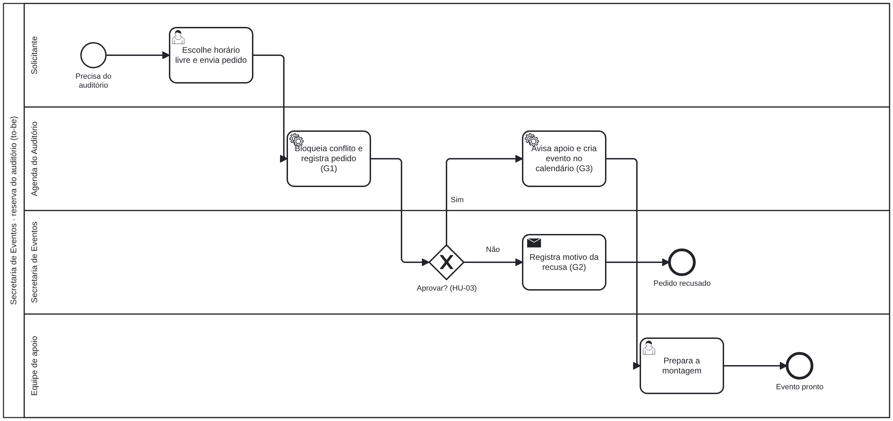

# claude-skill-doc-kit

**Skill do Claude que gera a documentação enxuta de um projeto — MVP, Histórias de Usuário (INVEST, Dado/Quando/Então, Definição de Pronto) e BPMN as-is/to-be — com avaliação automática da saída.**

Versão genérica e com dados fictícios do kit que criei na PUC Minas (IEC) e que hoje é o padrão de documentação de todo projeto novo submetido à GTI, a TI central da universidade.



## O problema

No módulo de cálculo financeiro da IEC/PUC Minas, a previsão para entender o processo, levantar e priorizar os requisitos e desenhar a solução era de **6 meses a 1 ano**. Documentação tradicional (SRS longo, catálogos, planos separados) virava excesso de informação para quem só precisava saber o que o projeto resolve e o que vem primeiro.

## Resultado

Com o kit e IA, o processo foi entendido, os requisitos elicitados e priorizados e a solução desenhada e **entregue em 1 semana**. O padrão passou a ser usado em todo projeto novo submetido à GTI. Cada documento é revisado pelo responsável antes de ir para a equipe — a IA rascunha, a pessoa decide.

## Como funciona

```
contexto do projeto (conversa, formulário, documentos)
   │
   ▼
SKILL.md ── fluxo: papéis → lacunas (máx. 3 perguntas) → MVP → histórias → BPMN
   │           regras: nunca inventar número/regra/sistema; [A CONFIRMAR] e [A MEDIR]
   │
   ├── templates/       estrutura e nível de detalhe de cada documento
   ├── references/      como escrever hipótese, métricas, INVEST, critérios, DoD
   ├── scripts/bpmn_from_spec.py   spec JSON → BPMN 2.0 com diagrama
   └── scripts/check_kit.py        avaliação da saída antes de entregar
   │
   ▼
mvp.md · historias.md · bpmn.md · <id>-asis.bpmn · <id>-tobe.bpmn
```

| Arquivo | Papel |
|---|---|
| [`SKILL.md`](.claude/skills/doc-kit/SKILL.md) | Prompt estruturado: quando usar, fluxo de trabalho, regras inegociáveis e voz |
| [`templates/`](.claude/skills/doc-kit/templates) | Modelos de MVP, Histórias, BPMN e spec de BPMN |
| [`references/escrita.md`](.claude/skills/doc-kit/references/escrita.md) | Hipótese, métricas acionáveis, INVEST, Dado/Quando/Então, Definição de Pronto |
| [`references/revisao.md`](.claude/skills/doc-kit/references/revisao.md) | Checklist de revisão humana |
| [`scripts/bpmn_from_spec.py`](.claude/skills/doc-kit/scripts/bpmn_from_spec.py) | Gera `.bpmn` que abre no Camunda Modeler, bpmn.io e draw.io |
| [`scripts/check_kit.py`](.claude/skills/doc-kit/scripts/check_kit.py) | Reprova história sem critério, critério vago ("rápido", "fácil"), história técnica, história G no MVP, placeholder esquecido, dado pessoal e HU citada no BPMN que não existe |

## Exemplo (fictício)

[`examples/agenda-auditorio/`](examples/agenda-auditorio) parte de um [pedido de formulário e notas de conversa](examples/agenda-auditorio/contexto.md) e chega em:

- [`mvp.md`](examples/agenda-auditorio/mvp.md) — hipótese, papéis, escopo, métricas com `[A MEDIR]` onde não há dado, releases e homologação
- [`historias.md`](examples/agenda-auditorio/historias.md) — 3 épicos, 6 histórias, 9 critérios Dado/Quando/Então, DoD e requisitos não funcionais
- [`bpmn.md`](examples/agenda-auditorio/bpmn.md) + `.bpmn` — as-is com 3 dores e to-be com 3 ganhos ligados às histórias

```
$ python3 .claude/skills/doc-kit/scripts/check_kit.py examples/agenda-auditorio
OK     6 histórias (5 no MVP), 9 critérios, 4 [A CONFIRMAR], 4 [A MEDIR]
```

## Decisões

- **Três documentos curtos, não seis.** Regras de negócio viram critérios de aceite; requisitos viram histórias; plano de homologação vira releases + checklist. Menos texto, mais decisão.
- **Lacuna explícita em vez de invenção.** O que não tem fonte vira `[A CONFIRMAR]` ou `[A MEDIR]`. Um modelo que inventa número bonito é pior que nenhum documento.
- **No máximo 3 perguntas, de uma vez.** O resto vira "Conversa" na história ou spike.
- **Avaliação automática + revisão humana.** O `check_kit.py` pega os erros mecânicos; o checklist de revisão pega o que exige julgamento.
- **BPMN como código.** A spec JSON é revisável em PR e gera o `.bpmn` sempre igual; a CI confere se os arquivos estão em dia.

## Como usar

**Claude Code (neste repositório):** a skill já está em `.claude/skills/doc-kit/`. Abra o repo e peça: _"use o doc-kit para documentar o projeto X a partir destas notas"_.

**Claude Code (em qualquer projeto):** copie a pasta para `~/.claude/skills/doc-kit/`.

**Claude.ai:** compacte a pasta `doc-kit` em `.zip` e envie como skill nas configurações de Skills.

**Scripts sozinhos** (Python 3.10+, sem dependências):

```bash
python3 .claude/skills/doc-kit/scripts/bpmn_from_spec.py examples/agenda-auditorio/tobe.json -o tobe.bpmn
python3 .claude/skills/doc-kit/scripts/check_kit.py examples/agenda-auditorio
python3 -m unittest discover -s tests
```

## Sobre os dados

A instituição, os setores, o pedido e os números do exemplo são **fictícios**. Nenhum documento, nome ou sistema interno da PUC Minas foi publicado; a versão interna usa uma biblioteca própria de documentos homologados.

---

Feito por [Felipe Sobrinho](https://felipe-nephew.vercel.app) · Licença MIT
