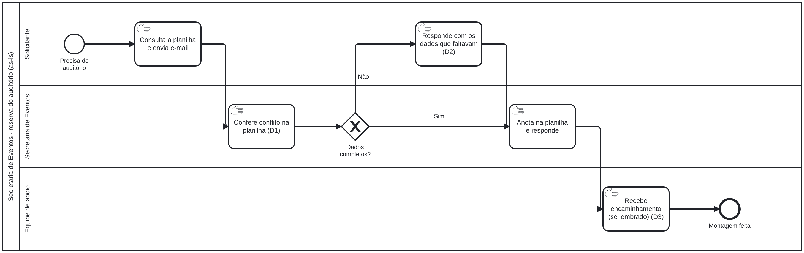

# BPMN — Agenda do Auditório

**Processo:** reserva do auditório · **As-is validado por:** Secretaria de Eventos · **Arquivos:** `agenda-auditorio-asis.bpmn`, `agenda-auditorio-tobe.bpmn`

## As-is — planilha e e-mail
O solicitante consulta a planilha, manda e-mail e espera; a Secretaria confere a planilha e responde; a equipe de apoio só recebe o pedido se alguém encaminhar.

| # | Dor | O que acontece |
|---|---|---|
| 1 | Conferência manual | A Secretaria confere conflito olhando a planilha, sem bloqueio |
| 2 | Pedido incompleto | Faltam dados no e-mail e é preciso perguntar de novo |
| 3 | Aviso esquecido | A equipe de apoio depende de um encaminhamento manual |

**Causa raiz:** a regra de conflito e o aviso dependem da memória de quem opera a planilha — resolvida por HU-02, HU-03 e HU-04.

## To-be — agenda com aprovação
O solicitante só consegue pedir horários livres; a Secretaria decide com motivo; o aviso para a equipe de apoio e o evento no calendário saem na aprovação.

| # | Ganho | História |
|---|---|---|
| 1 | Conflito bloqueado na origem | HU-02 |
| 2 | Decisão registrada com motivo | HU-03 |
| 3 | Aviso automático à equipe de apoio | HU-04 |

## O que muda
| Etapa | As-is | To-be |
|---|---|---|
| Verificar horário | Planilha compartilhada | Agenda com horários livres (HU-01) |
| Pedir | E-mail livre | Formulário com campos obrigatórios (HU-02) |
| Aprovar | Resposta por e-mail | Aprovação com motivo no sistema (HU-03) |
| Avisar a equipe de apoio | Encaminhamento manual | Aviso e evento no calendário na aprovação (HU-04) |
